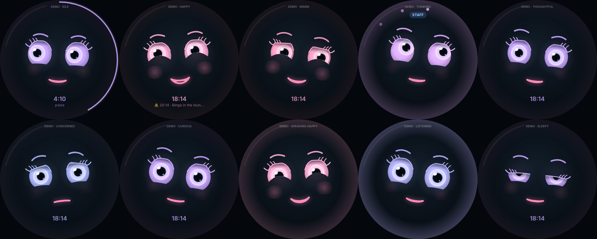

# Setting up the Empathika box (Raspberry Pi 5)

From a blank SD card to Empathika's face on the screen: about 45 minutes, most of it waiting.

## 1. Prepare the SD card (on your Mac)

1. Install **Raspberry Pi Imager** from <https://www.raspberrypi.com/software/> and insert the SD card.
2. Choose:
   - **Device:** Raspberry Pi 5
   - **Operating system:** Raspberry Pi OS (other) → **Raspberry Pi OS Lite (64-bit)**. Empathika draws her own
     screen, so the desktop version isn't needed.
   - **Storage:** your SD card
3. When asked to **apply OS customisation settings**, choose **Edit settings** and fill in:
   - **Hostname:** `empathika`
   - **Username and password:** your choice (remember them)
   - **Wireless LAN:** your WiFi name and password, **country GB**. This is how the box joins your WiFi
     the first time.
   - **Locale:** time zone Europe/London, keyboard gb
   - **Services** tab: **Enable SSH** with password authentication
4. Write the card, put it in the Pi, and connect the power. Wait about 3 minutes for the first start.

## 2. Connect to the box from your Mac

```bash
ssh YOUR-USERNAME@empathika.local
```

(Type `yes` the first time, then your password.) If `empathika.local` isn't found, wait a minute and try
again, or look up the Pi's address in your router's device list.

## 3. Copy Empathika onto the box

On your **Mac**, from the folder that contains `empathika-assistant`:

```bash
rsync -a --exclude node_modules --exclude dist --exclude data empathika-assistant YOUR-USERNAME@empathika.local:~/
```

This includes your `.env` (keys and settings). Then, on the **box** (over SSH), check these settings in
`~/empathika-assistant/.env` with `nano ~/empathika-assistant/.env`:

| Setting | On the box |
| --- | --- |
| `PULSE_SERVER` | **Delete this line** if it's there (it's for the Mac sound bridge) |
| `PANEL_PASSWORD` | Set one: the control panel will be reachable from your home network |
| `REALTIME_BARGE_IN=on` | Recommended: the mic board's echo cancellation lets you talk over Empathika |
| `COMPOSE_PROFILES=empathika` | Starts Empathika with the voice services |
| `MEMORY_KEY` | Keep the same value as on your Mac |

## Installing on Max's box

Empathika runs on exactly the same box and set-up as Max. To try her on Max's box (with Max removed
or not running):

1. Copy Max's `.env` into the `empathika-assistant` folder: the AI model, voice, audio, wake word and
   keys all work unchanged. Settings only Max used (Home Assistant, Composio, Spotify, work hours) are
   ignored. Then paste **`.env.trial`** at the end of it and fill in the lines marked `<-- FILL IN`: it
   has every setting the trial needs (Gemini real-time voice with a female voice, the greeting, the care
   app, the network name) and cancels Max's own voice, style and rules.
2. Run `sudo ./scripts/pi/setup.sh` as below. It answers the same questions (screen, connector) and
   changes `COMPOSE_PROFILES=max` to `empathika` by itself. Set `EMPATHIKA_HOSTNAME=max` before it if
   the box should keep its old network name (`max.local`).
3. The wake word: `hey_max.tflite` is included, so `WAKEWORD_NAMES=hey_max` keeps working until
   "Hey Empathika" is trained.
4. Check these in the copied `.env`, which are Max's choices: `TTS_VOICE` / `REALTIME_VOICE` (Max's male
   voice; remove them for Empathika's female defaults), and `LLM_SYSTEM_PROMPT` / `REALTIME_STYLE` (if set,
   they replace Empathika's care-home rules; the setup warns about them).

Max's memory is not carried over: Empathika starts with an empty resident memory (her own storage).

## 4. Run the setup

On the box:

```bash
cd ~/empathika-assistant
sudo ./scripts/pi/setup.sh
```

It asks which screen is fitted (round DSI, round HDMI or none), installs everything, then builds and
starts Empathika. The first build takes 10–15 minutes on a Pi 5. When it finishes:

```bash
sudo reboot
```

After the restart, Empathika's face appears on the screen and she's listening for "Hey Empathika".

## Using the box

- **Control panel:** <http://empathika.local:8099> from any phone or computer on your WiFi.
- **Boot screen:** while the box starts (and shuts down) it shows Empathika's face on a dark screen instead of
  raspberries and scrolling text. To use **your own logo**:
  1. Make a **PNG** picture, ideally square, about **400 × 400 pixels**, with the important part inside a
     circle (the screen is round) and a transparent or dark background.
  2. Name it **`boot-logo.png`** and put it in the `empathika-assistant` folder on your Mac (next to `README.md`).
  3. Send Empathika to the box as usual (the `rsync` command) and run `sudo ./scripts/pi/setup.sh` on the box,
     then `sudo reboot`.

  To go back to Empathika's face, delete `boot-logo.png` from the folder on the Mac **and** on the box
  (`rm ~/empathika-assistant/boot-logo.png`), then run the setup again. `EMPATHIKA_BOOT_LOGO=off sudo ./scripts/pi/setup.sh`
  leaves the boot screen alone.
- **Cards on the screen:** when there's something worth seeing, Empathika shrinks to a small face at the top and
  a card fills the screen; tap **Back to Empathika** (or wait) to return.
  - **Timer done / reminder:** with **OK** / **Again**, or **Done** / **Snooze 10 min**.
  - **Answers worth seeing:** when something is easier to see than hear (a list, a forecast), Empathika puts it
    on screen as well as saying it.
  - **Family messages:** when Empathika passes on a message from the family, it is on screen too, for residents
    who'd rather read it.
- **Notifications:** a card when a **message from the family** arrives ("💌 Sarah sent you a message"), with
  **Read it to me** (reads it out exactly as written) and **Later**. It waits for a good moment: never while
  someone is talking to Empathika, never over a card in use, and never while she is locked.
  - **Captions** (off unless you switch them on in **Settings → Screen** on the control panel): what Empathika
    heard you say and what she's saying, under the face.
- **Glance (while Empathika is idle):** the weather at the top (for the care home's location set on the control
  panel, from Open-Meteo: free, no key) and the next reminder under the clock. **Tap the face** for today at a
  glance: the date, the weather and the reminders still to come.
- **Evening photo frame:** upload the resident's pictures on the control panel (**Settings → Screen**; JPEG, PNG
  or WebP, kept on the box only) and switch it on; photos the family sends arrive there by themselves. During the
  hours you choose (19:00–23:00 by default), after two quiet minutes, the pictures fade one into the next with the clock on top. "Hey Empathika" or a touch brings
  her face back. The glance can be switched off there too.
- **Staff:** hold a finger on the screen for 2 seconds → **Staff**, or say "Empathika, staff mode": a 4-digit PIN
  keypad. The PIN (each member of staff has their own, set on the control panel's **Staff** tab) opens a staff
  session for a few minutes, shown at the bottom of the screen with **End**. Once any staff are set up, turning
  the box off, restarting, WiFi setup and updates from the screen need a staff session; residents only get
  volume and brightness. After 5 wrong PINs the keypad pauses. Every sign-in and care-record lookup is in the
  staff activity log.
- **Volume and brightness:** hold a finger on the screen for 2 seconds: the menu has **Volume** and
  **Brightness** with − and + buttons. Or say "Empathika, louder", "volume to 30%", "dim the screen", or use
  **Settings → Device** on the control panel. Brightness is remembered when Empathika restarts.
- **Start-up code:** in **Settings → Security** on the control panel, set a 6-digit code. From then on, every
  time the box starts, Empathika shows a keypad and stays locked until the code is typed: she won't answer
  ("I'm locked, please enter my code on the screen"), won't run any action, and her screen shows nothing
  personal (no family messages, notifications or reminders; reminders that come due are said once
  she's unlocked). Empathika restarting on her own (an update) doesn't lock her again; turning the box off and on
  does. To lock her yourself, hold a finger on the screen for 2 seconds and tap **Lock**.
  - After 5 wrong tries the keypad pauses for 30 seconds, then 1, 2, 4... up to 15 minutes. Turning the box
    off and on doesn't reset this, and the control panel's "current code" boxes count towards the same tries.
  - Changing or turning off the code needs the current code. **Forgot it?** If the control panel has a
    password (`PANEL_PASSWORD`), sign in and use **Remove code**; otherwise delete `data/startup-code.json`
    in the `empathika-assistant` folder on the box and restart Empathika.
  - Only a scrambled fingerprint of the code is stored, never the code itself.
- **Turning off and on:** never just pull the plug (it can damage the SD card). Instead:
  - **Hold a finger on the screen for 2 seconds** for the menu: **Turn off**, **Restart**, **WiFi setup**
    (and volume and brightness).
    After choosing, you have 5 seconds to cancel. When the screen goes dark it's safe to unplug.
  - Or say **"Empathika, turn off"** / **"Empathika, restart"** (she asks you to confirm), or use **Settings → Device**
    on the control panel.
  - Or press the **power button on the Raspberry Pi** once.
  - **To turn it on again:** press the Pi's power button (or unplug and plug the power back in).
- **Changing WiFi:** if the box can't reach a known WiFi network for a minute, or you choose **WiFi
  setup** in the screen's menu, Empathika says so and shows a QR code. Scan it with your phone: it joins Empathika's temporary
  "Empathika-Setup" network and opens a page where you choose your WiFi and type its password. Empathika tells you
  when she's connected. If nobody uses the setup network for 10 minutes, it switches itself off and the
  box tries your known networks again.
  To leave setup mode (e.g. you opened it by mistake), tap **Back to Empathika** under the QR code: the box goes
  back to your usual WiFi straight away. Every screen in the menu has a **Back to Empathika** button.
- **The face:**

  

  - **Lip-sync:** her voice is analysed 20 times a second for its sound shape, so the mouth makes
    an open "a", a wide "ee", a round "oo", shows teeth on "s" and closes on "m".
  - **Expressions follow what she says:** apologies and problems look concerned, good news looks
    happy, questions look curious, "let me check" looks focused, timers and reminders look
    surprised. The expression relaxes back to neutral a few seconds after she finishes.
  - **Natural movement:** blinking, quick glances, breathing, a head tilt when she listens, and eyes
    that look up and away while she thinks.
  - It's asleep at night (23:00–07:00, `FACE_SLEEP` in `.env`), shows the time, timers counting
    down around the edge, what's playing, and a WORK or GUEST badge in those modes.
- **Preview on your Mac:** with Empathika running in Docker on the Mac, open <http://localhost:8098/?demo> to
  see every expression. To hold one, use its name, e.g. `?demo=happy`, `?demo=speaking-concerned`
  or `?demo=asleep`.

## Trying the face on your Mac (before the box arrives)

With Empathika running in Docker on your Mac (`docker compose --profile empathika up -d --build`):

1. Open <http://localhost:8098> in a browser and make the window square-ish.
2. Say "Hey Empathika" and ask something. The face listens, thinks, and its mouth moves with her voice.
   Try "what's the weather?" then something she can't do: her expression changes with the answer.
3. Or test without the microphone: type to Empathika with voice output, keeping the face in the browser:
   ```bash
   docker compose stop empathika
   docker compose run --rm --service-ports empathika node dist/tools/chat.js --speak
   ```
   (Afterwards: `docker compose --profile empathika up -d`.)
4. If the mouth moves a little **before** you hear the words, set `FACE_AUDIO_DELAY_MS=200` in `.env`
   (try 150–300) and restart Empathika. The Mac sound bridge buffers audio; the box usually needs less or none.

## Updating

Once the setup has run on the box, updates come **straight from GitHub**: no Mac, no `rsync`, no SSH.

- **On the box's screen:** hold it for 2 seconds and tap **Update**: it shows what's new and offers
  **Update now**.
- **Control panel → Settings → Updates** shows the installed version and, when there's a newer one, the list
  of what's new (the titles of the changes merged on GitHub). Press **Update now**.
- Or say **"Empathika, are there any updates?"** and **"Empathika, update yourself"** (she asks you to confirm).
- Or tick **Install updates automatically** (default 03:30): if there's something new, the box updates itself
  at night.

The box downloads the new version, runs the setup with the answers you gave the first time (kept in
`/etc/empathika/box.conf`), rebuilds Empathika and, only if a start-up setting changed, restarts. It takes 5 to 15
minutes; the face says "Updating…" and the control panel comes back by itself. Your `.env`, Empathika's memory,
your `boot-logo.png` and anything else that isn't part of the code stay as they are. If something goes
wrong, the box stays on the version it had, and the control panel says so (details in
`/var/log/empathika-update.log`).

By hand, on the box: `sudo python3 /usr/local/lib/empathika/empathika-update.py`.

The very first time (to install this updater) it's the old way: copy the new version from your Mac with the
`rsync` command, then run `cd ~/empathika-assistant && sudo ./scripts/pi/setup.sh`.

## Troubleshooting

| Problem | What to do |
| --- | --- |
| Screen stays black | On a Pi 5, use the cable with **one narrow end** (22-pin, into the Pi) and one wide end (15-pin, into the screen); the cable with two equal ends is for older Pis. Check both ends are fully in with the latches closed. Then run the setup again and make sure you picked the connector the cable is really in (`CAM/DISP 0` or `1`, printed on the Pi): `sudo EMPATHIKA_DSI_PORT=0 ./scripts/pi/setup.sh` (or `=1`). |
| The desktop appears instead of Empathika's face | The card has Raspberry Pi OS **with desktop**. Run the setup again (it now switches the desktop off at boot), or by hand: `sudo systemctl disable lightdm && sudo systemctl enable empathika-face && sudo reboot`. To get the desktop back: `sudo systemctl enable lightdm && sudo reboot`. |
| Control panel won't open from the laptop | On the box, `docker compose ps` must show `0.0.0.0:8099->8099` for `empathika`; if it shows `127.0.0.1:8099`, run `docker compose -f docker-compose.yml -f docker-compose.pi.yml up -d` (the setup now makes this the default). On a Mac, if `curl http://<box address>:8099` works in Terminal but the browser doesn't, allow the browser in System Settings → Privacy & Security → Local Network. |
| A mouse pointer shows on the face | Run the setup again: it installs an invisible pointer for the face screen. If a mouse is plugged in, moving it over the face also hides the pointer. |
| Face shows "Reconnecting…" | Empathika isn't running: `cd ~/empathika-assistant && docker compose logs --tail 50 empathika` |
| No sound, or Empathika can't hear | `pactl list short sinks` and `pactl list short sources` should list the mic board (XVF3800). If not, check its USB cable, then run `systemctl --user restart empathika-audio-defaults`. |
| Empathika wakes up by herself (TV, music, noise) | Set `WAKEWORD_TRIGGER_LEVEL=2` in `.env` and run `docker compose -f docker-compose.yml -f docker-compose.pi.yml up -d`. The log line `Ignored a false wake-up` shows the double-check catching others. More: `training/README.md`, "Waking up by itself". |
| Empathika doesn't wake reliably | Run `./scripts/wake-coach.sh` from where you usually sit: it measures how well she recognises you and tells you what to change. |
| Face service | `journalctl -u empathika-face -n 50` |
| WiFi setup service | `journalctl -u empathika-wifi -n 50` |
| Start WiFi setup without the screen | `echo 1 \| sudo tee /run/empathika/wifi-request` |

## What was and wasn't tested

The face screen, the WiFi setup page and its logic (offline detection, wrong password, hidden networks,
long-press) were tested on a development machine with a simulated network manager. The setup script was
checked for errors but has not yet been run on a real Pi 5 with these parts: the screen's driver line,
the kiosk start-up and the mic board's sound names are the parts to watch on the first run. Send the
output if anything goes wrong.
